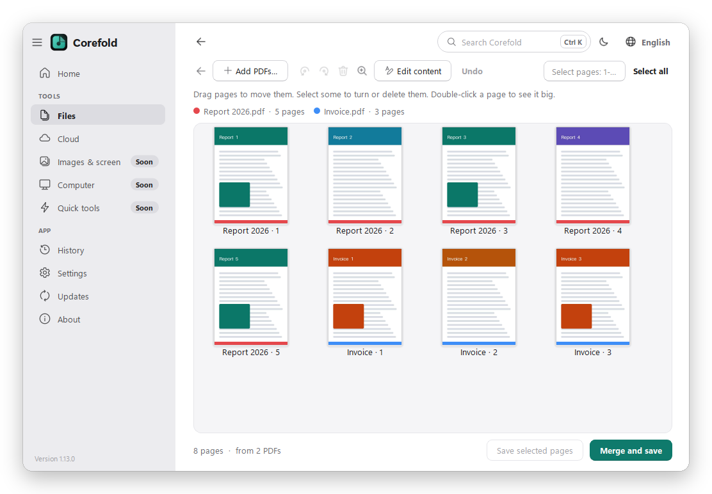
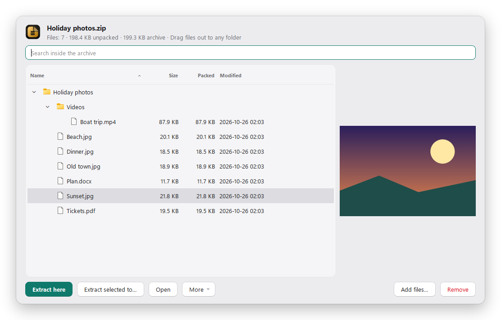
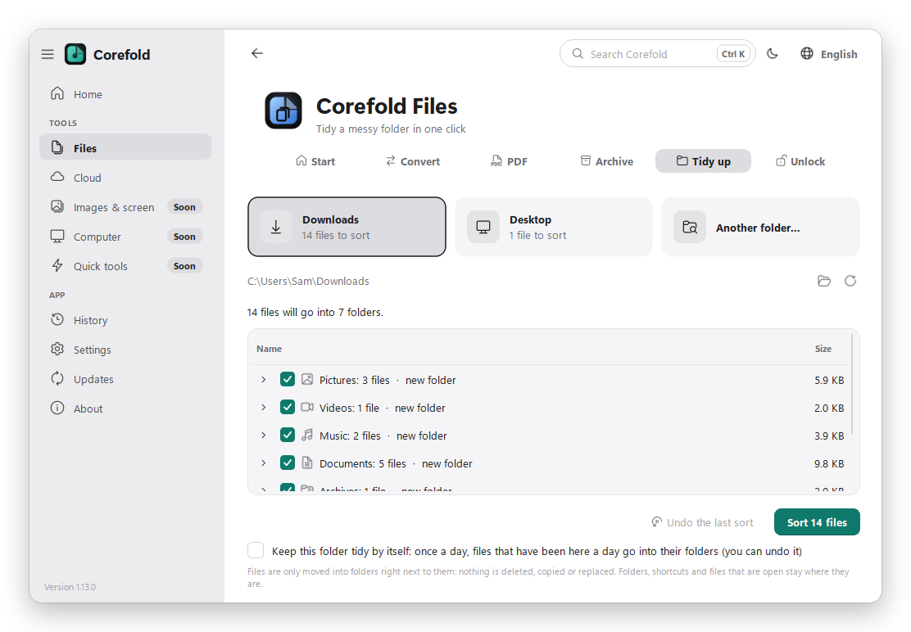
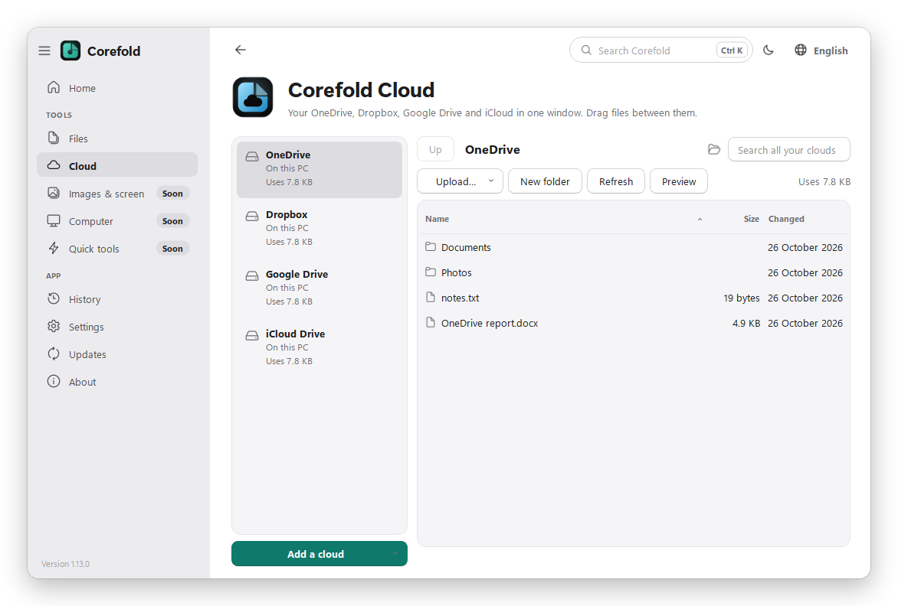
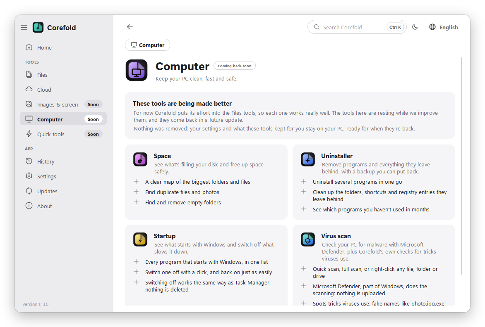

  

<h1 align="center">Corefold</h1>

  <b>Everyday tools for Windows, in one small app that waits in the tray.</b> 
  Convert any file with one drag, arrange and edit PDFs, open every archive, tidy your Downloads, and more. 
  Everything happens on your PC; nothing is uploaded.

  
  
  
  

<picture>
  <source media="(prefers-color-scheme: dark)" srcset="docs/screenshots/home-en-dark.png">
  
</picture>

## What's inside
This version puts everything into **Corefold Files**: one tool with one heading and a bar of what you
can use it for, so moving between its uses feels like one app, not several. Drop any file on its start
page to see everything you can do with it.

| | |
|---|---|
| **Convert** | Hold Shift while dragging a file, and a wheel of formats appears at your cursor. Drop it on one and it's converted: pictures, videos, music, PDFs and Office files. |
| **PDF** | Change what's in a PDF, merge, split and arrange PDFs by dragging page pictures, shrink them, turn pictures into a PDF, and lock them with a password. |
| **Archive** | Opens ZIP, RAR, 7z, ISO and more with a double-click. Drag files out, change a file inside and save it back, rescue damaged archives. |
| **Tidy up** | Sorts a messy Downloads or Desktop into clear folders with one click. See where every file will go first, and undo it all. |
| **Unlock** | Finds out which program is holding a file you can't delete or move, and asks it to let go. |
| **Cloud** | Has its own place in the sidebar: your OneDrive, Dropbox, Google Drive and iCloud in one window, found by themselves. Sign in to Google Drive right in Corefold, search every cloud at once and drag files from one to another. |

Switch off the uses you don't need (the ⚙ on the start page): a use that's switched off isn't loaded at all, so Corefold stays light.

<table>
  <tr>
    <td width="50%"><picture>
  <source media="(prefers-color-scheme: dark)" srcset="docs/screenshots/pdf-en-dark.png">
  
</picture></td>
    <td width="50%"><picture>
  <source media="(prefers-color-scheme: dark)" srcset="docs/screenshots/archive-window-en-dark.png">
  
</picture></td>
  </tr>
  <tr>
    <td width="50%"><picture>
  <source media="(prefers-color-scheme: dark)" srcset="docs/screenshots/organizer-en-dark.png">
  
</picture></td>
    <td width="50%"><picture>
  <source media="(prefers-color-scheme: dark)" srcset="docs/screenshots/cloud-en-dark.png">
  
</picture></td>
  </tr>
</table>

### Coming back soon
The other sections are resting for now while Corefold Files gets our full attention. Nothing of them
runs, and whatever they kept for you (settings, history, backups) waits untouched until they're back.

- **Images & screen:** Capture, Viewer, Player, Colors
- **Computer:** Space, Uninstaller, Startup, Virus scan
- **Quick tools:** Clipboard, Awake, Quick menu and quick wheel

<picture>
  <source media="(prefers-color-scheme: dark)" srcset="docs/screenshots/resting-en-dark.png">
  
</picture>

## The Converter wheel

<picture>
  <source media="(prefers-color-scheme: dark)" srcset="docs/screenshots/wheel-en-dark.png">
  
</picture>

Hold **Shift** while dragging a file in File Explorer or on the desktop. Drop it on a format and
it's converted next to the original, which is never moved or changed. Drop several files to convert
them all. You can also **right-click** a file → **Corefold**, or press **Ctrl + V** in Corefold to
convert a copied picture.

<b>Everything the Converter can do</b>

| Drop a… | You can |
|---|---|
| Image (PNG, JPG, WebP, HEIC, AVIF, GIF, BMP, TIFF, ICO) | convert to PNG, JPG, WebP, PDF, ICO, BMP · **resize** · **rotate / flip** · **crop** (free or square, 4:3, 16:9…) · **make it fit** a size (Discord, email) · **cut out** the background · **copy the text** in it · **watermark** · **stickers** for WhatsApp and Telegram · **scan** photos of paper into a PDF · turn pictures into a **video** · read QR codes · remove location & camera info |
| Video (MP4, MOV, MKV, WebM, AVI, WMV…) | MP4, MOV, WebM, MKV, GIF · **trim** · **make it fit** · rotate · **speed up / slow down** · **mute** · **fix the volume** · animated **stickers** and chat GIFs (WhatsApp, Telegram, Discord) · watermark · save **frames** · smaller copy · MP3 sound |
| Audio (MP3, M4A, WAV, FLAC, OGG, Opus, AIFF, WMA, AAC) | MP3, M4A, WAV, FLAC, OGG, Opus, AIFF · trim · make it fit · speed up / slow down · fix the volume |
| PDF | compress · make it fit · split · pages to images · extract text · merge several · **turn, delete or reorder pages** · save the **pictures** inside · **lock / unlock** with a password |
| Word, Excel, PowerPoint | PDF (uses Microsoft Office or LibreOffice if installed) |
| Archive (ZIP, RAR, 7z, ISO, TAR, GZ, CAB…) | **extract** (smart: no folder-in-a-folder) · extract to a folder · **browse** inside, open or take out single files · **test** · turn into ZIP or 7z · add / remove files (ZIP, 7z) |
| Any files or folders | make a **ZIP** or **7z**, with a password, max compression, or split into parts · **rename** many at once (numbers, replace text, add text — with undo) |
| Folder | convert every picture inside to JPG, PNG or WebP, or shrink them all for sharing |

**How do I know I'm seeing every option?** The middle of the wheel says how many options there are,
and dots show the pages. When there are more than fit, the last slice is **More**: click it, or hold
the dragged file over it for a moment. Options that don't fit the file are **dimmed** (point at one
to see why), and the middle tells you if you hid any in Settings. For the full list with nothing
hidden, drop the file on Corefold's **Home** page.

After a conversion the popup can **Compare** the new picture with the original (drag across it to see
the difference) or **Undo** a rename. **Do it again** (on the Home page and in the tray menu) repeats
your last action, with the same choices, on other files. When the wheel is opened from the
right-click menu, press **1–9** to pick a slice (0 = More).

Other ways to use it: **right-click** a file → **Corefold** → *Convert to PNG*, *Resize…*, *Extract here*…
(a normal Windows submenu, like 7-Zip's; on Windows 11 it's under *Show more options*, or Shift +
right-click). *All options…* at the bottom opens Corefold with the file. Prefer the wheel? Pick
**Corefold wheel** under *General → Right-click menu*. Or press **Ctrl + V** in Corefold (or *Convert
what's copied* in the tray menu) to convert a copied picture or copied files.

## A window that gets out of your way
<table>
  <tr>
    <td width="50%"><picture>
  <source media="(prefers-color-scheme: dark)" srcset="docs/screenshots/search-en-dark.png">
  
</picture></td>
    <td width="50%"><picture>
  <source media="(prefers-color-scheme: dark)" srcset="docs/screenshots/store-en-dark.png">
  
</picture></td>
  </tr>
</table>

Press **Ctrl + K** to find any tool, page or setting by typing. Drag the sidebar to put your tools in
your order, or shrink it to icons. Dark or light (or follow Windows), seven accent colours or your
own, and your own text size. The look is calm: soft greys, a flat window, and the accent colour only
where it means something (the main button, switches, what you're dragging). Questions, menus and
What's new open inside the window, never as extra windows. Every screen is built on **Atomic**, our
design system, so all of it looks and moves the same way.

## In your language
<table>
  <tr>
    <td width="50%"></td>
    <td width="50%"></td>
  </tr>
</table>

**English, العربية, Français, Español and Türkçe.** Corefold asks which language you want the first time it
starts, and the language button at the top of the window switches it any time, without restarting. In
Arabic the whole app is right-to-left.

## Private and light
- **Nothing leaves your PC.** No account, no tracking, no uploads. The only thing Corefold asks the
  internet is whether there's a newer version (you can switch that off).
- **Light on your PC.** Corefold waits in the tray using almost no memory or power. Conversions run at
  low priority and one at a time (both can be changed under *General → Keep my PC fast*), and memory it
  doesn't need is handed back to Windows when it's idle.
- **Careful with your files.** Originals are never changed, and Tidy up can undo a whole sort.

Read the full [privacy policy](PRIVACY.md).

## Installing
[**Download Corefold-Setup.exe**](https://github.com/SayedLabs/corefold/releases/latest), run it, keep
the two boxes ticked and click **Install**. That's it: a desktop icon, a Start menu entry, and Corefold
starts with Windows. No admin rights or Python needed. Installing a newer version on top upgrades it
and keeps your settings.

Windows may say *"Windows protected your PC"* the first time, because the app isn't signed yet:
click **More info → Run anyway**.

## Customizing
Open Corefold from the desktop icon (or click the teal tray icon):
- **General:** language, which key to hold (Shift, Ctrl + Shift or Alt), where new files go, image
  quality, a sound when done, dim or hide formats that don't fit, new names for batches, the
  right-click menu (Windows menu or the wheel), progress popups, start with Windows, and
  *Keep my PC fast* (background priority, one conversion at a time).
- **Look:** match Windows / dark / light, seven accent colours (Corefold teal to start with) or your own, wheel shape (classic,
  petals, slim, bubbles, neon, glass), size (up to huge), icons and/or text on slices, text size, how a
  slice lights up, colour slices by kind of action or in a rainbow, options per page, open under the cursor or in the middle,
  see-through, animations, number keys — all with a live preview. Also the text size in Corefold's
  windows, which corner popups appear in and how long they stay, and icons in the sidebar.
- **Sounds:** four soft "done" sounds made for Corefold (Corefold, Peel, Droplet, Glass) or none, a
  volume slider, a gentle sound when something fails, and an optional tick when the wheel opens.
- **Formats:** untick anything you don't use, ★ favourites to pin them to the top, ▲ ▼ to reorder.
- **History:** recent conversions (open them or show them in their folder) and your stats:
  files converted and space saved.

## Updates
Corefold updates itself, so you never have to download it again. It checks for a newer version a few
seconds after starting and every few hours. When there's a newer version it shows
**Update now**; one click downloads it, checks it isn't damaged, installs it and restarts Corefold
with all settings kept, in the same folder, with your desktop icon and Start menu entry. Afterwards it
shows what's new, and the **Updates** page has the version history: what every version changed. There
you can also let it install updates by itself.

## Uninstalling
Any of these works:
- In Corefold: **About → Uninstall Corefold…**
- Start menu: right-click **Corefold → Uninstall**
- Windows **Settings → Apps → Installed apps → Corefold → Uninstall**

It asks whether to delete your settings too. Files you converted are never touched.
(Portable version: **About → Remove settings and quit**, then delete the folder.)

## Licence
Corefold is free. Its code is MIT licensed ([LICENSE](LICENSE)), and the open-source parts it includes
are listed in [THIRD_PARTY_NOTICES.md](THIRD_PARTY_NOTICES.md).

## Working on Corefold
How to run it from the source, build it, test it on a real Windows PC and publish a release is in
[DEVELOPING.md](DEVELOPING.md).
